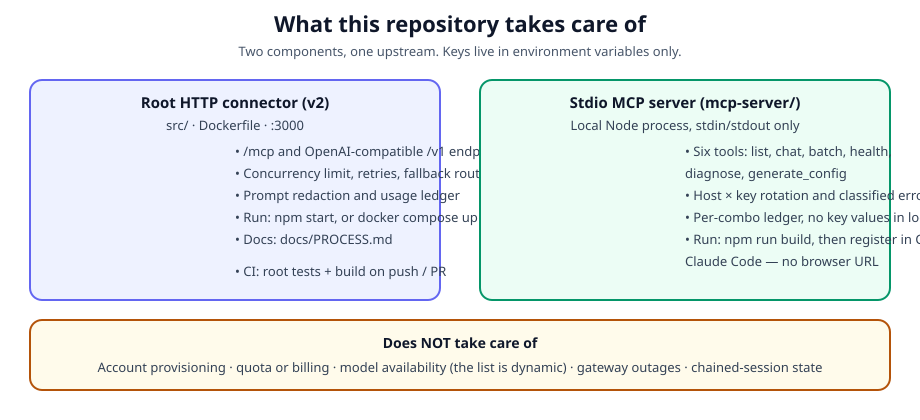

# AgentRouter Connector

[](https://github.com/Pr3eve6ti2o/agentrouter-connector/stargazers)
[](https://github.com/Pr3eve6ti2o/agentrouter-connector/actions/workflows/ci.yml)


AgentRouter Connector contains two components: the original v2 HTTP connector at the repository root and a new stdio MCP server in [`mcp-server/`](mcp-server/).



## What this repo takes care of

| Area | This repo handles | This repo does NOT handle |
| --- | --- | --- |
| Routing | Sending your prompt to AgentRouter, rotating hosts and keys (MCP server, v2), and retrying transient failures | Provisioning AgentRouter accounts, pools, or channels |
| Money and quota | Failing over to another key/pool when one is exhausted, and recording what was spent in a local ledger | Granting quota, billing, or bypassing provider limits, authentication, or WAF rules |
| Models | Listing the gateway's *live* model list and routing only to models on it | Deciding which models exist — the list is dynamic and can shrink (on 23 Oct 2026 it was only `gpt-5.6-sol`, `gpt-6-astra`, `gpt-6.1-sol`) |
| Failures | Classifying failures by status *and* body, so a 401 header rejection is never mistaken for a dead key, and a 502/disconnect is treated as a per-request lottery, not a dead host | Fixing the gateway itself, or making an off-list model return |
| Secrets | Keeping keys in environment variables only, redacting secret-like prompts, and never writing a key value into the ledger | Storing keys in the repo — never commit a `.env` file |
| Sessions | Stateless calls: every MCP call is a fresh, complete prompt with no `previous_response_id` | Protecting a chained Codex session — chained Responses state is pinned to one Azure resource, so a follow-up routed elsewhere can fail with a state-mismatch error; the fix is a fresh stateless request, never resuming the chain |

## Components

### Original v2 HTTP connector

The original v2 connector lives at the repository root and provides an HTTP gateway with:

- **MCP** at `/mcp`.
- **OpenAI-compatible endpoints** at `/v1/models` and `/v1/chat/completions`.

Limits: `MAX_CONCURRENCY=8` and `MAX_BATCH_TASKS=32`. It also handles retries with backoff (including `Retry-After`), explicit model fallback routes, prompt redaction, and a JSONL usage ledger. Full setup and verification: [`docs/PROCESS.md`](docs/PROCESS.md).

### New stdio MCP server (MCP v2, 2026-10-31)

The stdio MCP server in [`mcp-server/`](mcp-server/) was **designed and written by GPT-6-Astra**. **Orion** handled the integration, build and registration into terminals. The v2 revision (rotation, failover, caps, diagnostics — see below) was implemented by **GPT-6.1-Sol**.

- [Specification](mcp-server/SPEC.md)
- [Build notes](mcp-server/BUILD-REPORT.md)
- [Run guide](mcp-server/README.md) — setup, registration, tools, troubleshooting, updating
- [Troubleshooting and operations](docs/MCP-SERVER.md)

## Models

The gateway's model list is **dynamic** — always check `agentrouter_list_models` (or `GET /v1/models`) before choosing a model. Do not copy a model ID from an old example. The table below shows the models this server was designed around and how each is routed by the MCP server:

| Model | API | MCP server route | CLI |
| --- | --- | --- | --- |
| `gpt-6-astra` | Responses | `https://agentrouter.org/v1` (+ backup host in v2) | Codex CLI |
| `gpt-6.1-sol` | Responses | `https://agentrouter.org/v1` (+ backup host in v2) | Codex CLI |
| `gpt-5.6-sol` | Responses | `https://agentrouter.org/v1` (+ backup host in v2) | Codex CLI |
| `deepseek-v4-flash` | Responses | `https://agentrouter.org/v1` (+ backup host in v2) | Codex CLI |
| `claude-opus-5` | Anthropic Messages | `https://agentrouter.org/v1/messages` from the MCP server | Claude Code |
| `claude-opus-4-8` | Anthropic Messages | `https://agentrouter.org/v1/messages` from the MCP server | Claude Code |

Note: a Claude Code terminal itself is configured with base `https://agentrouter.org` (no `/v1`); the `/v1/messages` path above is the MCP server's upstream route. Codex serves Responses models; Claude Code serves Anthropic models — neither terminal serves the other's models at maximum settings, so two terminals are used for full coverage.

Effort ranges from `low` to `max`, except that MCP v2 **rejects `low` for `gpt-6-astra`** (it makes Astra burn its whole budget on reasoning) — omit effort for Astra, or use `max`. Two API keys are supported, with host × key failover in v2.

## MCP server (stdio)

The stdio MCP server is in [`mcp-server/`](mcp-server/). It is a local Node.js process, not an HTTP service: there is no browser URL, `stdout` is MCP traffic only, and your client (Codex or Claude Code) launches `node dist/src/server.js`.


### Tools

| Tool | Description |
| --- | --- |
| `agentrouter_list_models` | Returns the gateway's live model list. |
| `agentrouter_chat` | Makes a single call with a model and a prompt. Astra defaults to 12,000 output tokens, overridable to 16,000. |
| `agentrouter_batch_chat` | Runs calls in order, at most 32 per batch. Concurrency defaults to 1 (sequential) for Astra, otherwise 8. Every task retries through the same host × key rotation, and each result carries index, attempts, host, key index and classified kind, so only failed tasks need re-submitting. |
| `agentrouter_health` | Checks per host × key status via `GET /v1/models`, with no spend. |
| `agentrouter_diagnose` | Probes host × key × model combinations, classifies errors (including `upstream-transient`, `pool-quota-403` and `upstream-state-mismatch`) and reports per-combo success rates from the ledger. |
| `agentrouter_generate_config` | **WARNING: WRITES** to the real `~/.codex/config.toml` and `~/.claude/settings.json` files. |

### How to run it — MCP server

1. Clone this repository, then enter the cloned directory.
2. Enter the server directory and install dependencies:

   ```sh
   cd mcp-server
   npm install
   ```

3. Set the 14 required environment variables (2 keys + 12 per-model limits, see `mcp-server/.env.example`). Four optional MCP v2 variables have defaults and are not required: `AGENTROUTER_HOSTS` (default `agentrouter.org,ps.air-outer.com`), `AGENTROUTER_RETRY_ROUNDS` (default `3`), `AGENTROUTER_TIMEOUT_MS` (default `600000`), `AGENTROUTER_ASTRA_MAX_TOKENS` (default `12000`).
4. Build the server:

   ```sh
   npm run build
   ```

5. Smoke-check it (probes each model once; off-list models returning 503 is expected, not a build failure):

   ```sh
   npm run smoke
   ```

6. Register the stdio MCP server in Codex and/or Claude Code, then restart the client session so it loads the registration.

See [`mcp-server/README.md`](mcp-server/README.md) for full setup details, including the environment variables and registration instructions.

### How to run it — root HTTP connector

1. From the repository root, install dependencies and copy the example environment:

   ```sh
   npm install
   cp .env.example .env
   ```

   Edit `.env` with your own keys — never commit it. The root connector uses `AGENTROUTER_KEY`, `CONNECTOR_API_KEY` (for `/v1` clients) and `MCP_AUTH_TOKEN` (for `/mcp` clients), all different values.
2. Check, test and build:

   ```sh
   npm run check && npm test && npm run build
   ```

3. Start it (default port 3000, from `PORT` in `.env`):

   ```sh
   npm start
   ```

4. Verify it, in order — process only, then catalog, then a tiny generation (full sequence in [`docs/PROCESS.md`](docs/PROCESS.md)):

   ```sh
   curl -sS http://127.0.0.1:3000/health
   curl -sS http://127.0.0.1:3000/v1/models -H "Authorization: Bearer $CONNECTOR_API_KEY"
   ```

   Put the service behind HTTPS before exposing it publicly.

   Or run it with Docker:

   ```sh
   docker compose up --build
   ```

   This builds the Node 22 image, exposes port 3000, and loads `.env` via `env_file`.

### Authorship

- **Design (`SPEC.md`) and original MCP code:** GPT-6-Astra via AgentRouter, using both APIs.
- **[glue] Orion:** Glue, scaffolding, build and registration.
- **MCP v2 revision (2026-10-31):** GPT-6.1-Sol — host × key rotation, 502/transport failover, Astra caps and effort rules, both-host health/diagnose, rich ledger. Merged with the v3 run guide and the upstream state-mismatch classifier; pushed to `main` as `34c5a65`.

## Repository layout

- `src/`, `bin/`, `Dockerfile`, `docker-compose.yml` — the original v2 HTTP connector (the gateway). Its own docs are in `docs/PROCESS.md` and `docs/CONNECT_TO_CHAT.md`.
- `mcp-server/` — the stdio MCP server: `README.md` (setup and usage), `SPEC.md` (the design), `BUILD-REPORT.md` (build and glue log), `assets/` (diagrams used by the READMEs).
- `docs/MCP-SERVER.md` — troubleshooting and operations for the stdio MCP server.
- `.github/workflows/ci.yml` — CI for the root connector: `npm install`, `npm run check`, `npm test`, `npm run build` on push and pull request. It does not build the MCP server; build that separately with `npm run build` in `mcp-server/`.
