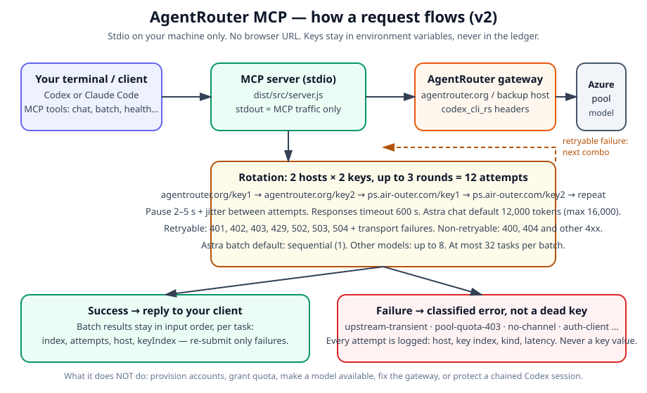

# AgentRouter MCP Server

[](https://github.com/Pr3eve6ti2o/agentrouter-connector/stargazers)




## 1. Scope and non-goals

This guide takes you from local setup to your first routed request. It is for readers who already have a repository checkout and two AgentRouter keys and want to set up a local MCP server. It covers setup, registration with your MCP client, the six tools, troubleshooting and updating.

You run the server as a local Node.js process from `mcp-server/`, using the built entry point `dist/src/server.js`. Your MCP client exchanges messages with it over stdin/stdout. This is a stdio server, not an HTTP service: there is no browser URL. The server sends upstream requests through AgentRouter to the Azure pool.

**Done means passing every completion gate in section 18:**

- **MCP exchange:** your client and the local server successfully exchange MCP messages.
- **Response:** a routed request returns a successful response.
- **Intended-pool evidence:** you have evidence that the same request went through AgentRouter and was handled by the intended Azure pool.

Starting the process, registering the server or getting a local MCP response does not, by itself, prove upstream execution. Local success and evidence that the intended pool handled the request are separate checks.

**Non-goals**

- Provisioning AgentRouter accounts.
- Provisioning or administering Azure pools.
- Making model availability decisions. The gateway’s model list is dynamic; this guide does not define a fixed set of available models.

To jump straight into setup, go to section 3.

## 2. Architecture and responsibilities

```text
                  LOCAL                  | UPSTREAM
[terminal] -> [stdio] -> [MCP server] ----|--> [AgentRouter] -> [Azure pool]
                                         ^
                              local/upstream boundary
```

Responsibilities belong to roles; one person may hold more than one.

| Party | Owns | Does not own |
|---|---|---|
| User | Installation, local configuration, build and checks. | Secret custody or upstream provisioning. |
| Key holder | Secrets, including supplying and protecting keys. | Local builds/checks or upstream provisioning. |
| Upstream owner | Provisioning, models, channels and quota. | Local setup, builds/checks or process lifetime. |
| Terminal / client | Manual process lifetime (terminal); registered-server process lifetime (client). | Local build/check responsibilities, secrets or upstream resources. |

The server is a local Node.js process from `mcp-server/`, with entry point `dist/src/server.js`. It uses stdio (`stdin`/`stdout`), not HTTP. For a registered server, the client—Codex or Claude Code—launches `node`.

`stdout` is MCP traffic only; diagnostics belong on `stderr`.

The configuration loader validates on import. The user owns preparing the configuration and running the checks; the key holder owns the secrets used by that configuration.

The server sends upstream requests through AgentRouter to the Azure pool. In MCP v2, requests rotate over host × key combos (`agentrouter.org/key1` → `agentrouter.org/key2` → `ps.air-outer.com/key1` → `ps.air-outer.com/key2`, then repeat, up to 3 rounds by default), retrying 401, 402, 403, 429, 502, 503, 504 and transport failures, and stopping immediately on 400, 404 and other 4xx. This routing does not transfer ownership of provisioning, models, channels or quota to the local server.

**MCP v2 at a glance — what this server takes care of:** rotating hosts and keys until a transient failure clears (or the retry budget runs out); classifying failures by status *and* body (so a 401 header rejection is never mistaken for a dead key); recording every attempt in a local ledger with host, key index, kind, attempts and latency — never a key value; probing both hosts for health and diagnosis; and applying safe Astra defaults (12,000 tokens, sequential batches, `low` effort rejected). It does not provision accounts, grant quota, make a model available, fix the gateway, or protect a chained Codex session. Full troubleshooting: [docs/MCP-SERVER.md](../docs/MCP-SERVER.md).

Check launch, MCP exchange and upstream execution separately. A running process does not prove a successful MCP exchange. A successful MCP exchange does not, by itself, prove that the Azure pool executed a request.

## 3. Choose your task

Start with your task, not a reading order. Shortcuts do not bypass readiness gates. Rerun affected gates after configuration or source changes.

| Task | Jump to | Entry gate (what must already be true) |
| --- | --- | --- |
| set up a fresh checkout | [4. Prerequisites](#4-prerequisites); [5. Install, environment and count check](#5-install-environment-and-count-check) | Checkout is in scope under [1. Scope and non-goals](#1-scope-and-non-goals). Prerequisites must pass before installation. |
| check the built entry point by hand | [8. Manual stdio check](#8-manual-stdio-check) | Prerequisites, installation, environment and count checks passed; [6. Build](#6-build) and [7. Smoke check](#7-smoke-check) passed for current code. |
| connect an MCP client | [9. Codex and Claude Code registration](#9-codex-and-claude-code-registration); [10. Tool discovery](#10-tool-discovery) | Build, smoke and manual stdio gates passed; results remain current under [18. Readiness gates](#18-readiness-gates). |
| change keys or model limits | [5. Install, environment and count check](#5-install-environment-and-count-check); [2. Architecture and responsibilities](#2-architecture-and-responsibilities) | Configuration responsibilities and secret-handling rules in [17. Security posture](#17-security-posture) understood. |
| rebuild after a code change | [6. Build](#6-build); [7. Smoke check](#7-smoke-check) | Prerequisites, installation, environment and count checks passed for the changed checkout. |
| run a first routed request | [11. First routed request](#11-first-routed-request); [12. The six MCP tools](#12-the-six-mcp-tools) | All earlier readiness gates passed, including client registration and tool discovery; results remain current. |
| investigate a failed check | [13. Troubleshooting by symptom](#13-troubleshooting-by-symptom); [14. Short FAQ](#14-short-faq); [16. Primary references](#16-primary-references) | Failed step or symptom identified; available output retained. No passing check required to troubleshoot. |
| update after pulling changes | [15. Updating and rebuilding](#15-updating-and-rebuilding) | Changes have been pulled into an existing checkout. |

if a gate has not passed, go back to it — do not skip ahead.

## 4. Prerequisites

You need:

- **Node.js 20 or newer** and **npm**. Tested with Node.js 24.
- **Git** and a local checkout containing `mcp-server/`.
- **Two AgentRouter keys**, authorised for the models you intend to use. One key is possible but leaves no fallback — see section 9.
- Network access to the **npm registry** and **AgentRouter**.
- A **POSIX shell**, such as Bash or zsh. On Windows, use WSL with Node.js and npm installed inside WSL.

**Only run setup and hold keys on a machine you trust. Never use a shared shell or CI runner.** Replace `<placeholders>` with your own values.

You do not need a global TypeScript installation.

### Dependency versions

The build report records these installed versions:

| Dependency | Recorded version | `package.json` range |
|---|---|---|
| `@modelcontextprotocol/sdk` | `1.32.1` | `^1.0.0` |
| `zod` | `3.25.76` | `^3.25.0` |
| TypeScript (`typescript`) | `5.9.3` | `^5.7.0` |

The repo files do **not** establish whether these versions are mandatory exact matches or an observed reference set. Do not treat them as required pins. `package.json` also declares `engines.node` as `>=20`.

### Check before continuing

1. Check the tools in the shell you will use for setup:

   ```sh
   node --version
   npm --version
   git --version
   ```

   You should see: Node.js v20 or newer, plus npm and Git version strings.

2. **If `node` or `npm` is missing, or Node is below v20:** install or upgrade Node.js 20+ with npm, following the official Node.js installation instructions for your system or using your existing version manager. If Git is missing, install it too. On Windows, do this inside WSL.

   Open a fresh shell and recheck. If tools are still missing or Node is still too old, correct the installation or shell `PATH` and repeat; do not continue until the checks pass.

   ```sh
   node --version
   npm --version
   git --version
   ```

   You should see: Node.js v20 or newer, plus npm and Git versions, without errors.

3. **Before any `cd`, verify your working directory.** These checks confirm that you are at the checkout root and that the server directory exists:

   ```sh
   pwd -P
   git rev-parse --show-toplevel
   ls -d mcp-server/
   ```

   If a command fails, the paths differ or `mcp-server/` is absent, locate the correct checkout root and repeat this check there before entering the server directory.

   You should see: the same checkout-root path from the first two commands, followed by `mcp-server/` from the last, without errors.

4. Only after the directory check passes, enter the server directory:

   ```sh
   cd mcp-server
   pwd -P
   ```

   You should see: your checkout-root path ending in `/mcp-server`.

## 5. Install, environment and count check

Stay in `mcp-server/` for this section; `dist/` means `mcp-server/dist/`.

### Step 1: Confirm the checkout, then enter `mcp-server/`

Check your current location:

```sh
pwd
ls
```

Confirm that this is the intended checkout root, not another project or copy. If it is not, locate the correct checkout before continuing.

You should see: the intended checkout-root path and an `mcp-server` directory in the listing.

```sh
cd mcp-server/
```

If `cd` fails, stop — later commands run against the wrong project.

You should see: no error from `cd`; your shell is now in the checkout’s `mcp-server/` directory.

### Step 2: Install and check dependencies

```sh
npm install
```

Continue only if the command exits successfully, with exit code `0`. A non-zero exit means stop and fix the installation before continuing. Warnings are not fatal errors, but a failed install is.

You should see: `npm install` completing successfully with exit code `0`.

Then check the installed top-level dependencies:

```sh
npm ls --depth=0 @modelcontextprotocol/sdk zod typescript
```

The build report and dependency declarations record different things:

| Package | Build report: installed version | `package.json` range |
| --- | --- | --- |
| `@modelcontextprotocol/sdk` | `1.32.1` | `^1.0.0` |
| `zod` | `3.25.76` | `^3.25.0` |
| `typescript` | `5.9.3` | `^5.7.0` |

The repository files do **not** establish whether those exact installed versions are mandatory or just a reference set. Do not treat them as required pins. A version differing from the report is not, by itself, a mismatch with the declared range.

If the check fails, a package is missing, or a version does not satisfy its declared range, stop. Confirm you are still in `mcp-server/`, then inspect `package.json` and any lockfile for unintended changes. Restore only accidental dependency-file changes, rerun `npm install` with the same success gate, then rerun the `npm ls` check above. If it still fails, resolve the dependency issue before continuing.

You should see: all three packages listed with versions satisfying their declared ranges, and no missing or invalid dependency errors.
### Step 3 — Prepare and check `.env`

From `mcp-server/`, run:

```sh
cp .env.example .env
git check-ignore .env
```

If the ignore check prints nothing, **STOP**. Add an ignore rule for `.env` to `.gitignore`, then repeat the check. Do not continue until it confirms that `.env` is ignored.

In `.env`, replace the two placeholders for `AGENTROUTER_KEY_1` and `AGENTROUTER_KEY_2` with real keys. **Never commit `.env` or either key.**

Check that all 12 limit values match these exactly:

```dotenv
AGENTROUTER_GPT_6_ASTRA_CONTEXT_TOKENS=1050000
AGENTROUTER_GPT_6_ASTRA_EFFORT_MIN=low
AGENTROUTER_GPT_6_ASTRA_EFFORT_MAX=max

AGENTROUTER_DEEPSEEK_V4_FLASH_CONTEXT_TOKENS=1048576
AGENTROUTER_DEEPSEEK_V4_FLASH_EFFORT_MIN=none
AGENTROUTER_DEEPSEEK_V4_FLASH_EFFORT_MAX=max

AGENTROUTER_CLAUDE_OPUS_5_CONTEXT_TOKENS=1000000
AGENTROUTER_CLAUDE_OPUS_5_EFFORT_MIN=low
AGENTROUTER_CLAUDE_OPUS_5_EFFORT_MAX=max

AGENTROUTER_CLAUDE_OPUS_4_8_CONTEXT_TOKENS=1000000
AGENTROUTER_CLAUDE_OPUS_4_8_EFFORT_MIN=low
AGENTROUTER_CLAUDE_OPUS_4_8_EFFORT_MAX=max
```

You should see: The ignore check prints `.env`, confirming it is ignored. Both key placeholders have been replaced with real keys (do not print them), and all 12 limit values match the specified settings exactly.

Step 4: The old bare count (`grep -Ec '^[A-Za-z_][A-Za-z0-9_]*=' .env`, expecting 14) is not airtight: empty, placeholder, duplicate or unrelated assignments can total 14, while `export`-prefixed and leading-whitespace assignments are missed. Use all 14 names below for two keys; for one key, omit `AGENTROUTER_KEY_2` (13 names).

```sh
for name in \
    AGENTROUTER_KEY_1 \
    AGENTROUTER_KEY_2 \
    AGENTROUTER_GPT_6_ASTRA_CONTEXT_TOKENS \
    AGENTROUTER_GPT_6_ASTRA_EFFORT_MIN \
    AGENTROUTER_GPT_6_ASTRA_EFFORT_MAX \
    AGENTROUTER_DEEPSEEK_V4_FLASH_CONTEXT_TOKENS \
    AGENTROUTER_DEEPSEEK_V4_FLASH_EFFORT_MIN \
    AGENTROUTER_DEEPSEEK_V4_FLASH_EFFORT_MAX \
    AGENTROUTER_CLAUDE_OPUS_5_CONTEXT_TOKENS \
    AGENTROUTER_CLAUDE_OPUS_5_EFFORT_MIN \
    AGENTROUTER_CLAUDE_OPUS_5_EFFORT_MAX \
    AGENTROUTER_CLAUDE_OPUS_4_8_CONTEXT_TOKENS \
    AGENTROUTER_CLAUDE_OPUS_4_8_EFFORT_MIN \
    AGENTROUTER_CLAUDE_OPUS_4_8_EFFORT_MAX
do
    awk -v name="$name" '
        $0 ~ ("^[[:space:]]*(export[[:space:]]+)?" name "[[:space:]]*=") {
            count++
        }
        END { printf "%s %d\n", name, count+0 }
    ' .env
done
```

**Missing** means `0` occurrences. **Empty** means an assignment exists but has no value, including empty quotes. **Placeholder** means a dummy value such as the literal `sk-...`. The loop only counts assignments; check values privately without printing secrets.

Keep `_CONTEXT_TOKENS` / `_EFFORT_MIN` / `_EFFORT_MAX` at `1050000 / low / max` for Astra, `1048576 / none / max` for DeepSeek, and `1000000 / low / max` for both Claude models.

**Pass condition:** every required name occurs exactly once with a non-empty, non-placeholder value.

You should see: Each required variable name is listed once with count `1` — 14 lines for a two-key configuration, 13 for a one-key configuration — with no values printed. If any count is `0` or more than `1`, stop, add the missing entry or remove duplicates in `.env`, then rerun the check. Only proceed when every count is `1` and every required value is non-empty and not a placeholder. The four optional MCP v2 variables (`AGENTROUTER_HOSTS`, `AGENTROUTER_RETRY_ROUNDS`, `AGENTROUTER_TIMEOUT_MS`, `AGENTROUTER_ASTRA_MAX_TOKENS`) are extra — they are not counted in the 14/13, and omitting them simply uses their defaults.

### Step 5 — Final note

`.env` lives at `mcp-server/.env`. Sourcing it in a shell only affects that shell (see section 7). The client-launched server in section 9 needs the full set of environment variables—both keys and all 12 limit values—through the client configuration, because the server does not read `.env` by itself.

**MCP v2 (2026-10-31) optional variables, all with defaults — a server started with only the original 14 variables keeps working unchanged:** `AGENTROUTER_HOSTS` (default `agentrouter.org,ps.air-outer.com`), `AGENTROUTER_RETRY_ROUNDS` (default `3`), `AGENTROUTER_TIMEOUT_MS` (default `600000`), `AGENTROUTER_ASTRA_MAX_TOKENS` (default `12000`).

## 6. Build

`<repository-root>` is the checkout root, so the server directory is `<repository-root>/mcp-server`.

1. **Build-status gate.** From `mcp-server/`, not the repository root, run the single build command below. The `build` script runs `tsc` and writes compiled JavaScript into that directory’s `dist/`. You do not need a global TypeScript installation.

   ```sh
   npm run build
   ```

   You should see: the build complete without TypeScript errors and exit with status `0`.

2. **Artefact gate.** After a successful build, use your editor or file browser to confirm that `dist/src/server.js` exists beneath `mcp-server/`.

   You should see: `server.js` present as a file in `mcp-server/dist/src/`.

**If the build fails, stop — do not proceed to smoke testing or registration with stale output.** An existing `dist/` directory does not override a failed build. Stop if the compiled entry point is missing, too.

The absolute-path form needed later is:

```text
<repository-root>/mcp-server/dist/src/server.js
```

Replace `<repository-root>` with the absolute path to your checkout root, not the server directory.

The launch target is this compiled JavaScript file, **not the TypeScript source**. The `start` script is `node dist/src/server.js`; the `smoke` script also uses compiled output: `node dist/smoke-test.js`.

**A successful build alone proves nothing about keys, MCP exchange or upstream access.** Passing these build and artefact gates is not a readiness check.

## 7. Smoke check

The working directory must be `mcp-server/`. Run both steps in the **same shell**: the smoke check needs the environment loaded there. Only source your own trusted `.env` file; sourcing executes its contents.

1. Load the environment. Do not continue if sourcing reports an error.

   ```sh
   set -a; . ./.env; set +a
   ```

   You should see: no sourcing errors; the file may load silently.

2. Run the check and capture its exit status immediately, before any other command:

   ```sh
   npm run smoke
   smoke_status=$?
   ```

   You should see: JSON containing `passed`, `failed` and per-model results, or a runner error if it throws.

### Read the result

The `package.json` smoke command is `node dist/smoke-test.js`. It probes **all four configured models using the first configured key**, not every key.

Read the `passed` and `failed` counts, then inspect each probe:

- `model`: which model was tested.
- `ok`: whether that probe passed.
- `status` and `kind`: read these together. `kind` comes from the status classifier, for example `ok` or `no-channel`.
- `ms`: probe timing in milliseconds.

The saved `smoke_status` is the **runner’s exit status**, not an aggregate model-health verdict. The script exits non-zero only if the runner itself throws. Per-model `503` responses are reported as results, not as script failures. Read the JSON; neither exit status zero nor a printed success marker is enough.

### Failure branches

- **Runner throw, including a missing key:** inspect the error. If no key is configured, correct the key configuration in your trusted `.env`, then repeat steps 1–2 in the same shell.

  You should see: the missing-key error cleared and, if the runner completes, JSON probe results that still need checking.

- **Per-model `503` / `no-channel`:** those probes failed because of upstream channel state. This is not a build failure, and a zero runner exit status does not make those probes pass.

- **Other statuses on failed probes:** use the affected `model`, `status` and classified `kind` to investigate the reported response. Do not assume every failed result means `no-channel`, or disregard it because the runner exited zero.

The build report’s live run on **2026-10-23** showed `gpt-6-astra` returning `200` / `ok`, while `deepseek-v4-flash`, `claude-opus-5` and `claude-opus-4-8` returned `503` / `no-channel`. That records upstream channel state at that time, not a build failure or a guarantee of current availability.

### What a pass does NOT prove

A pass covers only the documented probes, using that first key, at the time of the run. It does not prove:

- All models are available generally.
- The client-launched server will start with its own working directory and environment.
- MCP exchange works.

## 8. Manual stdio check

**Startup gate**

1. **Launch from the prepared terminal.** Use the same terminal in which you sourced `.env` in section 7. Run this from `mcp-server/` so the process inherits that terminal’s environment:

   ```sh
   node dist/src/server.js
   ```

   Do not type ordinary chat text into this process: it expects MCP protocol messages from a client. Keep stdout reserved for MCP traffic; diagnostic messages belong on stderr.

   If the process exits immediately, read the error. The most likely cause is a missing or invalid environment variable; see section 13.

   You should see: the process stays alive and the shell prompt does not return. A quiet terminal is normal; there is no chat prompt or HTTP listening URL.

2. **Stop the server.** Press **Ctrl+C** in the same terminal.

   You should see: the process stops and your shell prompt returns.

Passing this startup check proves only that the entry point starts with your environment.

**Separate MCP-exchange gate**

Startup does **not** prove an MCP handshake, tool discovery, credential validity or upstream access. Those need the checks in sections 9–11.

Even a successful local MCP exchange does not, by itself, prove upstream execution.

## 9. Codex and Claude Code registration

> **Why the full environment is required:** In `src/config.ts`, `loadConfig()` requires `_CONTEXT_TOKENS` (a positive safe integer), `_EFFORT_MIN` and `_EFFORT_MAX` for each of the four models, plus at least one of `AGENTROUTER_KEY_1` or `AGENTROUTER_KEY_2`. Validation runs **on import**, so a client-launched server given only keys fails validation and cannot start. The sources contain no dotenv loading: the process does **not** read `mcp-server/.env` itself. Pass the full set through the client configuration.

### Codex CLI 0.164.0-alpha.9

Replace the key placeholders with your keys and `<repository-root>` with your absolute repository path. The model settings below come from `.env.example`.

The server is at `<repository-root>/mcp-server/dist/src/server.js`: use the **mcp-server directory’s `dist` output**, not a `dist` directory at the repository root. Keep `--` before `node`; it separates client options from the server command.

Register the server, restrict access to the configuration file, then check the registration:

```sh
codex mcp add agentrouter \
  --env 'AGENTROUTER_KEY_1=<key-1>' \
  --env 'AGENTROUTER_KEY_2=<key-2>' \
  --env AGENTROUTER_GPT_6_ASTRA_CONTEXT_TOKENS=1050000 \
  --env AGENTROUTER_GPT_6_ASTRA_EFFORT_MIN=low \
  --env AGENTROUTER_GPT_6_ASTRA_EFFORT_MAX=max \
  --env AGENTROUTER_DEEPSEEK_V4_FLASH_CONTEXT_TOKENS=1048576 \
  --env AGENTROUTER_DEEPSEEK_V4_FLASH_EFFORT_MIN=none \
  --env AGENTROUTER_DEEPSEEK_V4_FLASH_EFFORT_MAX=max \
  --env AGENTROUTER_CLAUDE_OPUS_5_CONTEXT_TOKENS=1000000 \
  --env AGENTROUTER_CLAUDE_OPUS_5_EFFORT_MIN=low \
  --env AGENTROUTER_CLAUDE_OPUS_5_EFFORT_MAX=max \
  --env AGENTROUTER_CLAUDE_OPUS_4_8_CONTEXT_TOKENS=1000000 \
  --env AGENTROUTER_CLAUDE_OPUS_4_8_EFFORT_MIN=low \
  --env AGENTROUTER_CLAUDE_OPUS_4_8_EFFORT_MAX=max \
  -- node '<repository-root>/mcp-server/dist/src/server.js'

chmod 600 ~/.codex/config.toml
codex mcp list
```

You should see:

- An `agentrouter` entry.
- Command: `node`.
- Your absolute server path: `<repository-root>/mcp-server/dist/src/server.js`, with the placeholder replaced.
- Status: `enabled`.

`enabled` does **not** prove launch, handshake, credentials, quota or failover.

You may add the optional MCP v2 variables with extra `--env` entries (for example `--env AGENTROUTER_RETRY_ROUNDS=3`); omitting them uses the defaults in section 5. Re-register (or edit the client config and restart the server process) after changing any variable — the client-launched server does not pick up shell exports.
### Claude Code 2.1.308

Install Claude Code:

```sh
npm install -g @anthropic-ai/claude-code
```

For exactly 2.1.308, use `npm install -g @anthropic-ai/claude-code@2.1.308` instead.

Register the server with the full environment set from `.env.example`. Replace the key and repository-root placeholders.

Client config files contain plaintext keys. The `chmod` below restricts file access but does not remove keys from shell history.

```sh
claude mcp add --scope user agentrouter \
  -e AGENTROUTER_KEY_1='<key-1>' \
  -e AGENTROUTER_KEY_2='<key-2>' \
  -e AGENTROUTER_GPT_6_ASTRA_CONTEXT_TOKENS=1050000 \
  -e AGENTROUTER_GPT_6_ASTRA_EFFORT_MIN=low \
  -e AGENTROUTER_GPT_6_ASTRA_EFFORT_MAX=max \
  -e AGENTROUTER_DEEPSEEK_V4_FLASH_CONTEXT_TOKENS=1048576 \
  -e AGENTROUTER_DEEPSEEK_V4_FLASH_EFFORT_MIN=none \
  -e AGENTROUTER_DEEPSEEK_V4_FLASH_EFFORT_MAX=max \
  -e AGENTROUTER_CLAUDE_OPUS_5_CONTEXT_TOKENS=1000000 \
  -e AGENTROUTER_CLAUDE_OPUS_5_EFFORT_MIN=low \
  -e AGENTROUTER_CLAUDE_OPUS_5_EFFORT_MAX=max \
  -e AGENTROUTER_CLAUDE_OPUS_4_8_CONTEXT_TOKENS=1000000 \
  -e AGENTROUTER_CLAUDE_OPUS_4_8_EFFORT_MIN=low \
  -e AGENTROUTER_CLAUDE_OPUS_4_8_EFFORT_MAX=max \
  -- node "<repository-root>/mcp-server/dist/src/server.js"

chmod 600 ~/.claude.json
claude mcp list
```

You should see:

```text
agentrouter Connected
```

`Connected` does NOT prove launch, handshake, credentials, quota or failover.

You may add the optional MCP v2 variables with extra `-e` entries; omitting them uses the defaults in section 5. Re-register (or edit the client config and restart the server process) after changing any variable.

**One-key note:** Remove the `AGENTROUTER_KEY_2` entry, leaving 13 environment entries in total. Removing it does not remove any limit requirement, and one key leaves no fallback. Two keys do not prove both work.

| Symptom | Cause and action |
| --- | --- |
| The client-launched server exits with a missing-environment-variable error. | Your client environment is keys-only or incomplete — supply the full set and restart the server process. Do not assume a GUI client inherits terminal exports. |

Registering with either client, or both, is fine. The config paths assume default client locations.

## 10. Tool discovery

Start a fresh session with `codex` or `claude` so it loads the registration. Your client handles MCP initialisation and tool discovery.

Paste this into the client:

> List the tools exposed by the agentrouter MCP server and the required arguments for each. Do not send a provider request yet.

**You should see:**

- A tool list with the required arguments for each tool, taken from the client-reported schemas. This build exposes:
  - `agentrouter_list_models`
  - `agentrouter_chat`
  - `agentrouter_batch_chat`
  - `agentrouter_health`
  - `agentrouter_diagnose`
  - `agentrouter_generate_config`
- No connection or initialisation error.

Capture the client’s actual tool-list response, including the returned names and required arguments. Do not move on to provider checks until you have that evidence and have resolved any discovery errors or build mismatch. Use the names and schemas your client reports for your build rather than guessing tool names or copying this guide’s names blindly.

**If discovery fails or the list differs:**

- **Connection or initialisation error:** follow section 13.
- **Tool list differs from the six above:** treat this as a signal to check that you are running the rebuilt output. Verify that the client launch target is the rebuilt `dist/src/server.js` (see section 15), then start a fresh session and repeat the exchange.

Discovery proves that the MCP exchange works. It does **not** prove that any model is available or that any key is valid.

## 11. First routed request

This is a live request and may use paid quota. Set effort to **low** for this check — except for `gpt-6-astra`, where `low` is rejected with a clear error in MCP v2; for Astra, omit effort instead. Effort can go up to **max** for harder work — see section 12.

1. Choose a model ID returned by `agentrouter_list_models` for your key. The list is dynamic: do not copy a model ID from an old example.
2. Replace `<model-id>` below with that ID, then paste this prompt into the client:

   > Using the agentrouter MCP tools just listed, send one request through the discovered request tool to model `<model-id>` with the prompt "Reply with exactly OK". Show the tool result. Do not retry automatically.

3. If the client asks for approval, check that the requested tool belongs to agentrouter before allowing it.

**You should see:** an agentrouter tool invocation followed by a successful result containing `OK`.

**If it fails:**

- **No tool call:** this is not a server test, even if the client writes `OK`.
- **Upstream error:** go to section 13. Report both the **status and body**, with secrets redacted.

**Done evidence:**

- **Response:** save a sanitised copy of the tool response, noting the selected model and request time.
- **Intended pool:** separately capture any available evidence linking this request to the intended pool. A response alone is not pool attribution. If that evidence is missing, record intended-pool attribution as **unproven**.

A successful tool result containing `OK` proves that one routed request worked for that model/key at that time. It does not prove other models work, future availability, failover, or ledger coverage.

## 12. The six MCP tools

Paste tool requests into your MCP client, not your shell. Replace `<model-id>` with an ID returned by `agentrouter_list_models`.

Use the tool names and schemas your client reports for your build. The repo files do not provide complete input contracts, and this guide does not invent argument lists they do not state.

### Known/gap matrix

| Tool | Known | Not stated in the repo files |
| --- | --- | --- |
| `agentrouter_list_models` | Returns a dynamic list of model IDs. | Complete input contract. |
| `agentrouter_chat` | Sends one prompt to one model; supports the `low`/`max` effort guidance below, except Astra rejects `low`. Rotates host × key (see below). | Complete input contract beyond that guidance. |
| `agentrouter_batch_chat` | Up to 32 tasks; concurrency cap 8, default 1 for Astra, otherwise 8; ordered per-item results with attempts, host, keyIndex and kind; retries every task through the same rotation. | Per-item input contract beyond model + prompt; cap-violation handling beyond the 32-task limit. |

### `agentrouter_list_models`

Use this to find the model IDs you can use. The list is **dynamic**: listing a model does not guarantee usable access, and dated lists are not a catalogue.

**You should see:** a list of model IDs you can pass to the chat tools.

### `agentrouter_chat`

Send one prompt to one model. Set `effort` to `low` for checks — except for `gpt-6-astra`, where `low` is rejected; for Astra, omit effort (no reasoning field is sent) or use `max`. Effort can go up to `max` for harder work.

**MCP v2 rotation and failover (supersedes the pre-v2 502 gap):** requests rotate over host × key combos in order `agentrouter.org/key1`, `agentrouter.org/key2`, `ps.air-outer.com/key1`, `ps.air-outer.com/key2`, then repeat, for up to `AGENTROUTER_RETRY_ROUNDS` rounds (default 3 = 12 attempts), with a 2–5 s plus jitter pause between attempts. Retryable: 401, 402, 403, 429, 502, 503, 504, plus transport failures (fetch throw, connection closed, timeout). Non-retryable: 400, 404 and other 4xx break immediately. Responses timeout is 600 s by default; Anthropic `/messages` is 120 s unless overridden. For `gpt-6-astra`, `agentrouter_chat` defaults to 12000 output tokens (`AGENTROUTER_ASTRA_MAX_TOKENS`), caller-overridable to at most 16000.

The server appends a local ledger entry to `ledger.jsonl` by default, or to the path set by `AGENTROUTER_LEDGER_PATH`, carrying timestamp, model, tokens, host, key **index** (never a key value), status (or `null` for transport failure), error kind, attempts used, latency, and reasoning/text tokens. Relative paths are resolved against the server process working directory. Ledger writes are best-effort and must not fail the chat.

For the default ledger, run `tail -n 1 ledger.jsonl` in a shell from the server process working directory. If the path is overridden, use `tail -n 1` on the configured ledger file instead. Correlate the entry’s timestamp and model with your request; do not assume the latest entry belongs to it.

**You should see:** the model’s reply and a matching ledger entry.

### `agentrouter_batch_chat`

Send several requests in one batch. A batch accepts at most **32 tasks**; more throws a `RangeError`. Concurrency is capped at **8 tasks at once**, with a default of 1 (sequential) when any task uses `gpt-6-astra`, otherwise 8; the caller may override 1–8. Split larger jobs into separate batches.

Per-item results are `ok`/`error` pairs in request order, each carrying index, attempts used, host and `keyIndex`, plus a classified kind on failures, so a caller can re-submit only failed tasks. Partial failure is normal: a failed item does not fail the whole batch.

**MCP v2: batch now retries every task through the same host × key rotation as a single chat.** The pre-v2 warning that batch does not retry 502 failures no longer applies.

**You should see:** a response or a per-item error for each request.
### `agentrouter_health`

Check the router’s current health. Health alone does not prove that a model will serve a request.

The repo files do not state complete input contracts for these three tools. This known/gap matrix summarises the documented boundaries:

| Tool | Known | Gap or not stated in the repo files |
|---|---|---|
| `agentrouter_health` | Reports current router health, probing both hosts per host × key. | Check scope (local state versus live provider validation), whether checks send provider requests, and whether they create ledger entries are not stated. |
| `agentrouter_diagnose` | Runs failure diagnostics, probing both hosts, and reports per-combo success rates over the last 60 minutes from the ledger. | Full report fields/schema are not stated. |
| `agentrouter_generate_config` | Writes real client configuration files. | Preservation of unrelated settings, partial-write/failure behaviour and change logging are not stated. |

Paste:

> Call agentrouter_health and show me the health report.

**You should see:** The current health status and any reported problems.

### `agentrouter_diagnose`

Run diagnostic checks when a request fails.

If you configure two keys, failover follows host × key rotation (see section 12). HTTP **401, 402, 403, 429, 502, 503, 504**, plus transport failures, trigger rotation to the next combo; 400, 404 and other 4xx do not retry. The pre-v2 statement that 502 does not trigger failover no longer applies.

The build report records a default probe scope of **four models × two keys**. In the **2026-10-23** live run, `gpt-6-astra` returned `200/ok` on both keys; the other three models returned `503 no-channel`. These are recorded results, not a guarantee of current availability.

Diagnose classifications in MCP v2 include `upstream-state-mismatch` (including the exact body "created under a different Azure OpenAI resource" — see `docs/MCP-SERVER.md`), `upstream-transient` (502/504/transport), and `pool-quota-403` (403 quota, distinct from 402). The report’s full fields/schema are not stated; do not treat this mapping as a complete result specification.

Paste:

> Call agentrouter_diagnose and summarise any failed checks.

**You should see:** Which diagnostic checks passed and details of any failures.

### `agentrouter_generate_config`

Write the configuration files for Codex and Claude Code.

**WARNING: This tool WRITES the real `~/.codex/config.toml` and `~/.claude/settings.json` files — it is not a preview. Do not run it casually, including as a tool-availability check. Back up any existing files before proceeding.**

The generated content is **client provider configuration**:
- Codex uses `model_provider` set to `agentrouter`.
- Claude Code uses `apiKeyHelper` to read `CODEX_GATEWAY_API_KEY` at runtime.

This is **not** the MCP server registration described in section 9. Do not confuse the two.

The repo files do not say whether unrelated settings survive, what happens after a partial write or failure, or whether changes are logged. **Diff the files after the call**, comparing them with your backups where available.

Paste:

> Ask for my confirmation and wait for my explicit approval before calling agentrouter_generate_config. Only after I approve, call it to write the Codex and Claude Code configuration files.

**You should see:** A confirmation request first; after approval, the generated configuration in both real files.

## 13. Troubleshooting by symptom

- **Build failed?** → See section 6.
- **Server process exits at once?** → Check environment completeness: all 14 variables, or 13 in one-key mode. Startup throws if any required variable is missing. Check the environment configured in the client, not just your shell.
- **Client cannot initialise or list tools?** → Check stdio and the launch target. Is the client launching the rebuilt `dist/src/server.js`? `stdout` must contain MCP traffic only; send diagnostics to `stderr`.
- **Tools list fine, but requests fail?** → Use the upstream symptom table below.

Quietness alone is never failure. For **every upstream diagnosis, capture both the HTTP status and response body** and match them together. Never declare a key dead from a 401 alone.

| Symptom | Cause | Fix | You should see |
|---|---|---|---|
| **401** with a body mentioning **client-headers** | The gateway rejects client-identification headers. This is a header-rejection error, not an invalid-token error. | Check and correct the headers on the **server’s upstream HTTP requests**, not stdio input. Keep the token unchanged while checking. | The upstream response no longer reports the client-headers rejection. |
| **401** with a body mentioning **invalid token** | The key is missing, malformed, expired or rejected. | Correct or replace the key in the process environment, then restart the process. | Authentication is accepted; the invalid-token error clears. |
| **402** with a **budget-pool error** in the body | The pool cannot authorise spend. | Check pool assignments: the repo files do **not** say whether the keys share a pool. **If they use different pools**, fail over to the other key. **If they share a pool**, replenish or reassign the pool instead; replenishing or reassigning is also an alternative to failover. Pools refill, but no refill timing is given. | Once the selected pool can authorise spend, the budget-pool rejection clears. |
| **503** with a **no-channel** body | No eligible route exists for the request. The model list is dynamic. | Fetch the live list; do not treat dated snapshots as a catalogue. The 2026-10-23 and 2026-10-28 snapshots listed `gpt-5.6-sol`, `gpt-6-astra` and `gpt-6.1-sol`; DeepSeek and Opus were off-list with 503. | A request using a currently routable model reaches an eligible route instead of returning 503/no-channel. |
| Intermittent `502` | Transient upstream failure. The ~1-in-5 observation is dated 2026-10-24 and is **not a guarantee**. | In MCP v2, retry is automatic: the server rotates host × key (default 3 rounds) and batch retries every task the same way. No manual retry is needed unless the retry budget is exhausted. | The affected request may succeed on a later combo once the upstream fault clears. |
| Azure state-mismatch on chained Responses | Responses state is pinned to one Azure resource. This does **not** affect the MCP server or stateless runners. | Start a fresh stateless request. Omit `previous_response_id` and other resource-bound references; do **not** resume the chain. | No chained-state mismatch on the fresh request. `diagnose` classifies the original failure as `upstream-state-mismatch`. |
| Startup environment-validation errors | Missing or malformed variables in the client-launched process. | Correct the client’s environment configuration, then restart the launched process. Do not assume a GUI client inherits terminal exports. | Startup completes without environment-validation errors. |
| Quiet terminal / no browser URL / malformed stdio messages | The stdio server waits for MCP messages. Non-MCP output on stdout can corrupt messages. | Connect through an MCP client. Keep stdout for MCP traffic **only**; send logs to stderr. | A successful initialise/tools-list exchange. A quiet terminal before MCP messages arrive is normal; no browser URL is expected. |

**Live model-list check**

Run this separately for each key against the **upstream gateway**, not the stdio server. Replace `<main-host>` with scheme + hostname only: no `/v1` and no trailing slash. Supply that key’s bearer token and the exact client-header name and value required by the gateway.

```sh
curl -i '<main-host>/v1/models' \
  -H 'Authorization: Bearer <key>' \
  -H '<gateway-required-client-header-name>: <gateway-required-client-header-value>'
```

Also check `agentrouter_list_models` and `agentrouter_health` through your MCP client. The upstream and MCP checklists differ; neither alone proves a request will succeed.

**You should see:** one HTTP 200 result per key with the currently advertised model IDs. If either check fails, use its status **and body** with the table.

**Asking for help safely — see section 17**

Include:

- Failing stage.
- Sanitised build output.
- Client launch target.
- Initialise/tools-list result.
- Observation date.
- Host and model.
- Sanitised error and `diagnose` output.

Replace secrets with `<placeholders>`. Never share raw `.env` dumps or unredacted configuration.

## 14. Short FAQ

**Does appearing in `agentrouter_list_models` mean I can use that model?**

No — the list is dynamic, and being listed does not mean you have usable access. A request can still return `503 no-channel`. See sections 12 and 13.

**Does a 401 mean my key is dead?**

No — never call a key dead from a 401 alone. Read both the status and the response body: a client-headers rejection is a header problem, not a dead key; only an invalid-token body points at the key. See section 13.

**Does a 402 mean my key is permanently broken?**

No — a 402 is a budget-pool problem. Pools refill, but no refill timing is given; if both keys share a pool, rotating keys will not help. See section 13.

**Will a failed batch request retry itself, including on 502?**

Yes, in MCP v2 — batch retries every task through the same host × key rotation as a single chat (default 3 rounds, 2–5 s plus jitter between attempts). This supersedes the pre-v2 answer. See sections 12 and 13.

**Does a quiet terminal mean startup failed?**

No. Stdio servers wait for MCP messages, so a quiet terminal does not by itself indicate a startup failure.

**Does “1 in 5” guarantee that a particular retry will succeed?**

No — “1 in 5” was an observation from 2026-10-24. It is not a guarantee that any particular retry will succeed.

## 15. Updating and rebuilding

1. **Back up and check the environment.** Save `.env` and any client config you are about to edit or regenerate. Do not assume an update preserves `.env` automatically. Check for new or renamed environment variables: a client-launched server can fail if the client still passes the old set. Re-run section 5’s named-variable check against the environment the client actually supplies, not just your shell, and correct any mismatches.

   You should see: Recoverable backups and the required variable names supplied by the client.

2. **Pull, install and build before restarting.** From `mcp-server/`’s parent checkout, set `<server-repo>` to the path to `mcp-server/`, so the install and build run there:

   ```sh
   cd <server-repo> && git pull --ff-only && npm ci && npm run build
   ```

   `npm ci` is the updating form; section 5 uses `npm install` for a fresh installation. After pulling, check `.env` against your backup and the updated requirements. Do not restart until the build succeeds: otherwise, the client may keep launching old compiled output.

   You should see: A successful install and build, with `.env` present and checked against the updated requirements.

3. **Verify what the client actually launches.** Confirm that its launch target resolves to this checkout’s rebuilt `dist/src/server.js`. Restart the client-managed MCP server, confirm that the old process stopped and that its replacement uses that target, then check the initialisation handshake. Successful initialisation and tool listing alone do **not** prove that the client replaced its process or launch target.

   You should see: A replacement process running the rebuilt target and a successful handshake—not merely a successful build.

4. **Retest discovery and routing.** Re-run tool discovery and make a first routed request. When routing changes, refresh the live model list before testing. Date new availability or retry observations. Keep the section 16 observations dated 2026-10-23, 2026-10-28 and 2026-10-24 clearly labelled as historical snapshots, not evidence of current availability.

   You should see: The expected tool list and a response from the intended route, with dated notes for new availability or retry observations.

5. **Treat generated configs as a separate update.** If you used `agentrouter_generate_config`, back up existing generated files and affected client configs **before** regeneration. Regenerate as needed, review the changes—including any changes to unrelated settings—and retest after applying the reviewed output. Restart the client-managed server and repeat the handshake, tool discovery and routed request.

   The repository files do not state that generated configs refresh automatically or that unrelated settings survive; do not assume either. Do not assume writes are atomic. Check that the output is complete and keep backups available for recovery.

   You should see: A reviewed configuration containing only intended changes, complete output and successful retests.

stale environment or a stale launch target can preserve old behaviour even when the compiled code is current.

## 16. Primary references

These in-repo files are the authority for this guide. Where this guide and a dated observation disagree, the live check in section 13 wins. Documented configuration does not establish current service availability.

| Source | Date | Claim | Support |
|---|---|---|---|
| `docs/MCP-SERVER.md` | Not supplied | Startup requirements; HTTP failure taxonomy; model availability and 503 recovery; batch retry limitation; Responses state mismatch; security. | Documented troubleshooting and operations. |
| `mcp-server/.env.example` | Not supplied | The 14-variable template. | Configuration reference, not evidence of deployed values. |
| `mcp-server/config-schema.json` | Not supplied | Keys; four model definitions with APIs, bases and contexts; caps of `maxConcurrency` 8 and `maxBatchTasks` 32. | Documented schema, not a live model catalogue. |
| `mcp-server/BUILD-REPORT.md` | 2026-10-23 | Glue pass, build gate, live test results and registration snippets. | Historical build and test evidence. |
| `mcp-server/src/config.ts` | Not supplied | Import-time validation. | Source-level behaviour. |

“Not supplied” means no date has been established here, not that the file itself is necessarily undated.

### Dated-evidence register

- **2026-10-23 — historical live-test snapshot.** The live model list contained `gpt-5.6-sol`, `gpt-6-astra` and `gpt-6.1-sol`. `deepseek-v4-flash` and both Opus models were off-list and returned 503 `no-channel` on both keys. Source: `mcp-server/BUILD-REPORT.md`. **Do not treat as current.**

- **2026-10-24 — reported 502 observation.** During the “502 lottery”, roughly one in five requests landed. That was an observation, not a success-rate guarantee. **Provenance missing:** no supporting dated artefact is supplied; this report remains uncorroborated here. **Do not treat as current.**

- **2026-10-28 — reported repeat snapshot.** The same “GPT-6-only” snapshot shape was reported: `gpt-5.6-sol`, `gpt-6-astra` and `gpt-6.1-sol` listed; `deepseek-v4-flash` and both Opus models off-list with 503 responses. The quoted label describes that snapshot, not a standing model catalogue. **Provenance missing:** no supporting dated artefact is supplied for this repeat observation; it remains uncorroborated here. **Do not treat as current.**

## 17. Security posture

- Keep keys only in environment variables. Never commit `.env`: before adding secrets, run `git check-ignore .env` and confirm it prints `.env`. Keep only placeholders in `.env.example`.
- Only source your own trusted `.env` file. Use the wallet-style rule adapted from the Bawa bar: generation and setup belong on a trusted interactive machine, not a random online shell or CI runner just because the commands run there.
- Set client configuration files to mode `600`: `chmod 600 ~/.codex/config.toml ~/.claude.json`. This permits owner read/write only; it does not remove keys from shell history.
- Never put real keys into source control, issues, chat, CI logs or test fixtures.
- The server never logs its credential-bearing config object to MCP stdout. Stdout must stay MCP traffic only.
- Review evidence yourself before sharing. Do not assume automatic sanitisation, or that a ledger exists or covers the failing stage.

Use this checklist when asking for help. Check every shared item for secrets, including build output and ledger excerpts.

| Action | Evidence and handling |
|---|---|
| Share | Observation date; failing stage and symptom; build target and build output; client launch target; host/model. |
| Share | The 14-variable check result, without values; initialise/tools-list result; model-list/health output. |
| Share | Redacted response status **and** body; relevant ledger excerpts if available. State when ledger coverage is unknown rather than treating missing entries as proof that nothing happened. |
| Redact | Key values, tokens, secret-bearing headers, `.env` values and generated-config values. Replace each with `<redacted>`. |
| Omit | Raw `.env` dumps, unredacted client config files and full environment dumps. Share the checked results above instead. |

a redacted report is still diagnosable — status AND body (with secrets removed) is what separates a header problem from a token problem.

## 18. Readiness gates

Mark each gate pass or fail. Treat an unmet or unverified check as a failure. A model list or health response on its own is not readiness.

| Gate | Check (section) | Pass looks like | Not proved by passing |
|---|---|---|---|
| Environment complete | Validate the full variable set (section 5). | All 14 variables named in section 5 (13 in one-key mode) are present with non-empty, non-placeholder values that are correct for this setup. | A working build or a successful request. |
| Build | Verify the current build (section 6). | `dist/src/server.js` has been built from the current checkout. | That the client launches this build. |
| Client target | Verify the launch path and restart (sections 9, 15). | The client launches the rebuilt artefact path, and the server process has actually been restarted. | A working stdio connection or successful tool execution. |
| Stdio | Test through the client (section 10). | The client initialises successfully over stdio and completes `tools/list`. | That listed tools execute successfully. |
| Six tools | Compare the tool inventory (sections 10, 12). | The client lists all six tools expected for this build. | That every tool works or `generate_config` preserves unrelated settings. |
| Live model list | Fetch models per key (section 13). | Current model IDs are fetched for each configured key, with HTTP 200 for every response. | Access to every listed model or a successful routed request. |
| Routed request | Make an end-to-end request (section 11). | One request through an agentrouter tool, using a model from the live list, returns OK. | Access to other models, future availability, failover or complete ledger/health coverage. |

### What passing does NOT prove

- **Access to every model.** The list is dynamic; a 503 no-channel response can still occur.
- **Future availability.** A successful request now does not guarantee availability later.
- **Failover**, unless you have actually observed a failover.
- **Complete ledger or health coverage.** Both are partly unstated.
- **That `generate_config` will preserve unrelated settings.**

the setup is ready when every gate passes; a single passing gate is not readiness.

## 19. About this guide
I wrote this guide with GPT-6-Astra. The repo files and live checks in sections 13 and 16 remain the authority.
